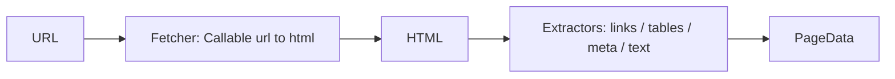

<p align="center">
  
</p>

<h1 align="center">Web Scraper Python</h1>

<p align="center">
  <strong>HTML extraction — links, tables, and metadata — with a pluggable fetcher, in pure-stdlib Python.</strong><br>
  Resolve relative URLs, parse tables into rows, pull title/meta, and strip text — all offline-testable.
</p>

<p align="center">
  <em>Built and maintained by <a href="https://viprasol.com">Viprasol Tech</a> — Fintech Experts. Full-Stack Builders.</em>
</p>

<p align="center">
  <a href="https://github.com/Viprasol-Tech/web-scraper-python/actions/workflows/ci.yml"></a>
  <a href="LICENSE"></a>
  
  <a href="https://t.me/viprasol_help"></a>
  <a href="https://github.com/Viprasol-Tech/web-scraper-python/stargazers"></a>
</p>

---

> ## Offline by design
> The **fetch** step is a pluggable `Callable[[str], str]` (`url -> html`). The default `FixtureFetcher` serves canned HTML from an in-memory mapping, so the demo and the entire test suite run with **no network, no API keys, and no heavy dependencies** (stdlib `html.parser` only — no `requests`, `bs4`, or `lxml`). For production, inject your own HTTP callable (e.g. one built on `urllib.request`). Always scrape responsibly: respect `robots.txt`, rate limits, and each site's terms of service.

---

## Features

- **Pluggable fetcher** — swap the transport via one `Callable[[str], str]`; a deterministic fake ships built-in.
- **Link extraction** — relative URLs (`/about`, `../x`) resolved to absolute against the page URL; fragments skipped.
- **Table parsing** — every `<table>` becomes a list of rows of cell strings (`<th>` and `<td>`).
- **Metadata** — `<title>` plus `<meta>` `name`/`property`/`http-equiv` content (incl. Open Graph).
- **Text extraction** — visible text with tags, `<script>`, and `<style>` stripped and whitespace collapsed.
- **Stdlib only** — built on `html.parser`; no third-party scraping libraries.
- **CLI** — `web-scraper-python demo` scrapes a built-in sample page offline.
- **Modern tooling** — ruff, mypy (strict), pytest, GitHub Actions CI.

## Quickstart

```bash
git clone https://github.com/Viprasol-Tech/web-scraper-python.git
cd web-scraper-python
python -m pip install -e ".[dev]"

# Scrape the built-in sample page, fully offline:
web-scraper-python demo
```

## Usage

```python
from web_scraper_python import Scraper
from web_scraper_python.scraper import FixtureFetcher

html = '<title>Hi</title><a href="/about">About</a>'
fetcher = FixtureFetcher({"https://example.com/": html})

page = Scraper(fetcher).scrape("https://example.com/")
print(page.title)  # "Hi"
print(page.links)  # ["https://example.com/about"]  -> resolved absolutely

# Bring your own transport for real HTTP:
from urllib.request import urlopen


def http_fetch(url: str) -> str:
    with urlopen(url) as resp:  # noqa: S310 - caller-controlled URL
        return resp.read().decode("utf-8", "replace")


page = Scraper(http_fetch).scrape("https://example.com/")
```

## Architecture



## Roadmap

- [x] Stdlib extractors: links, text, tables, metadata
- [x] Pluggable fetcher with a built-in offline fake
- [x] `PageData` model + CLI demo
- [ ] Optional `urllib`-based HTTP fetcher with retry/backoff
- [ ] `robots.txt` awareness and polite rate limiting
- [ ] Multi-page crawling with a frontier queue

## Contributing

PRs welcome — see [CONTRIBUTING.md](CONTRIBUTING.md) and our [Code of Conduct](CODE_OF_CONDUCT.md).

## Contact — Viprasol Tech Private Limited

- Website: [viprasol.com](https://viprasol.com)
- Email: [support@viprasol.com](mailto:support@viprasol.com)
- Telegram: [t.me/viprasol_help](https://t.me/viprasol_help) | WhatsApp: +91 96336 52112
- GitHub: [@Viprasol-Tech](https://github.com/Viprasol-Tech) | [LinkedIn](https://www.linkedin.com/in/viprasol/) | X [@viprasol](https://twitter.com/viprasol)

## License

[MIT](LICENSE) (c) 2025 Viprasol Tech Private Limited
